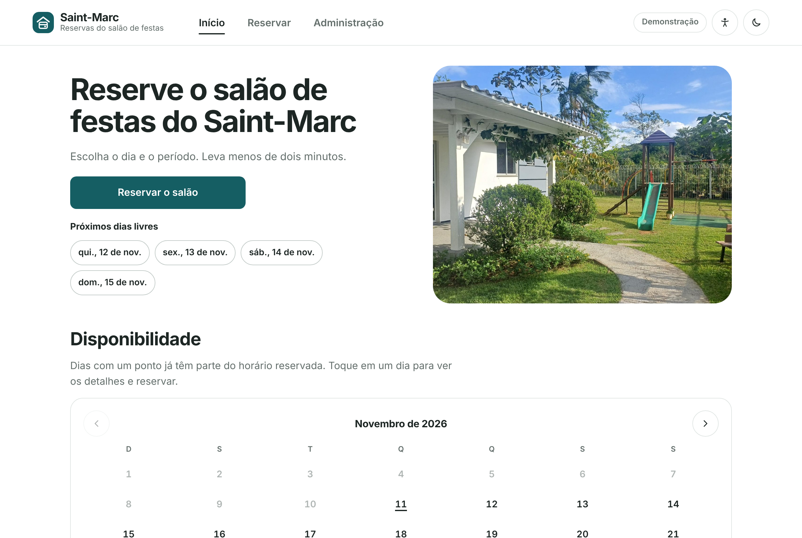
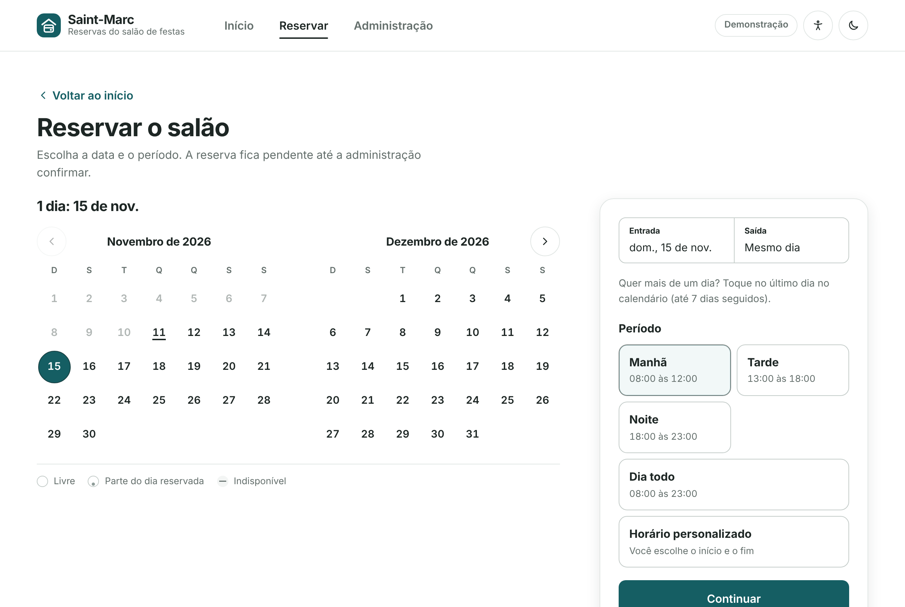
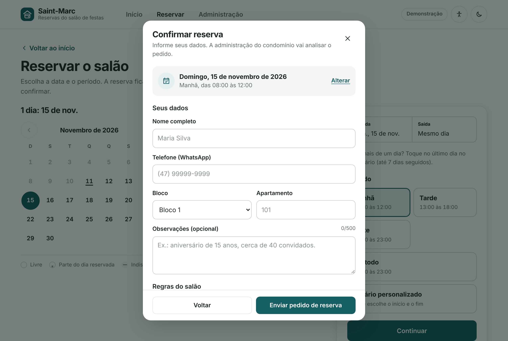
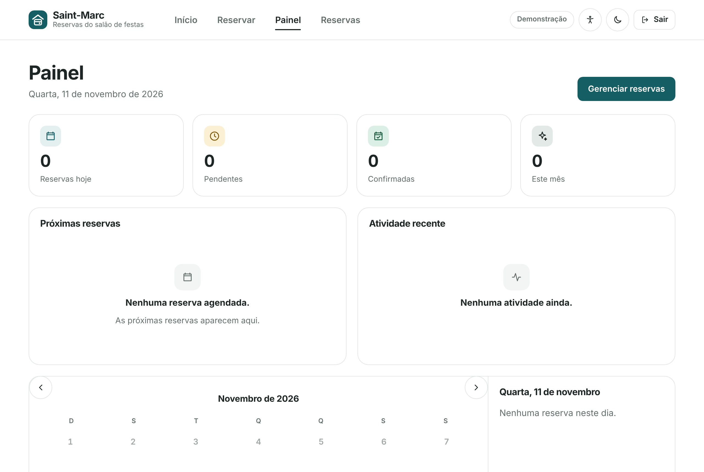
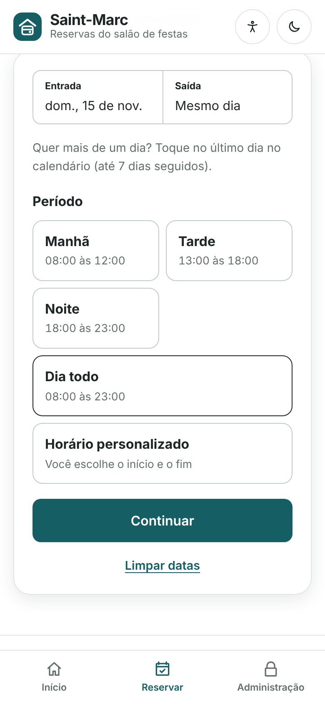
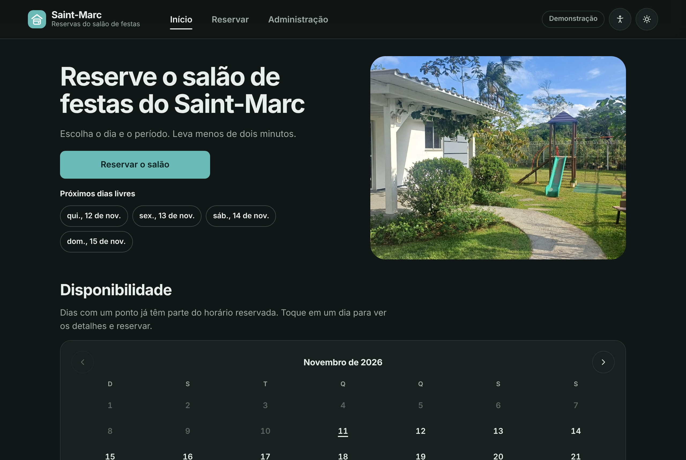

# Reservas Saint-Marc

Sistema de reservas do salão de festas do Condomínio Saint-Marc. Os moradores veem os dias livres e reservam um período (manhã, tarde, noite, dia todo ou horário personalizado), ou vários dias seguidos, direto do celular. A administração aprova, rejeita e acompanha tudo em um painel. Não há cobrança: o sistema só organiza datas e horários.



## Sumário

- [Dois modos de uso](#dois-modos-de-uso)
- [Funcionalidades](#funcionalidades)
- [Capturas de tela](#capturas-de-tela)
- [Como executar](#como-executar)
- [Documentação](#documentação)
- [Tecnologias](#tecnologias)
- [Estrutura do projeto](#estrutura-do-projeto)
- [Publicação](#publicação)
- [O que o projeto demonstra](#o-que-o-projeto-demonstra)
- [Autor](#autor)

## Dois modos de uso

O modo é escolhido automaticamente pela configuração.

| | Modo local (padrão) | Modo conectado (uso real) |
| --- | --- | --- |
| Reservas | Começam vazias; ficam no navegador de quem usa | Banco compartilhado (Supabase) |
| Conta da administração | Criada por você no primeiro acesso, guardada no navegador | Real, com e-mail e senha (Supabase Auth) |
| Configuração | Nenhuma; roda até sem internet | [Guia do Supabase](docs/SETUP_SUPABASE.md) |

> No modo local, a conta do administrador é criada por você na tela de login e guardada como hash neste navegador: não há conta padrão. Isso não é segurança de servidor (quem tem acesso ao aparelho pode apagar os dados). Para uso real, use o modo conectado, em que as permissões são aplicadas pelo banco.

## Funcionalidades

**Moradores**
- Página inicial direta: foto do salão, botão "Reservar o salão", próximos dias livres e calendário de disponibilidade.
- Calendário com dois meses no computador e um no celular; dias indisponíveis riscados e um ponto nos dias parcialmente ocupados.
- Reserva por período (Manhã 08:00–12:00, Tarde 13:00–18:00, Noite 18:00–23:00, Dia todo) ou horário personalizado.
- Vários dias seguidos (até 7), sempre dia todo.
- **Cadastro por apartamento:** na aba Cadastro, o morador salva nome e telefone ligados ao seu bloco e apartamento, protegidos por uma senha numérica. Nas próximas reservas os dados já vêm preenchidos.
- Regras do salão com aceite obrigatório antes de enviar.
- Lista de espera para dias ocupados.
- Guardar a data na agenda (arquivo `.ics` ou Google Agenda).
- Aviso opcional à administração pelo WhatsApp.
- Instalação como aplicativo no celular (PWA).

**Administração**
- Painel com reservas de hoje, pendentes, confirmadas, do mês, próximas reservas, atividade recente e calendário.
- Lista de reservas com busca e filtros; aprovar, rejeitar, cancelar e excluir.
- Mensagem pronta ao morador (WhatsApp ou copiar) ao aprovar, rejeitar ou cancelar, com link do Google Agenda.
- Aba **Moradores** com os cadastros (busca, ligar, WhatsApp e remover; a senha nunca aparece).
- Lista de espera com aviso de que o dia liberou.
- Datas bloqueadas para manutenção, assembleias e obras.

**Regras de negócio**
- Funcionamento das 08:00 às 23:00; sem datas ou horários passados.
- Dois eventos nunca ocupam o mesmo horário; no modo conectado o próprio banco garante isso, mesmo com envios simultâneos.
- Reservas rejeitadas ou canceladas liberam o horário.
- O calendário público nunca mostra nomes ou telefones.
- Só a conta de administrador cadastrada entra na área administrativa; não existe login padrão.

**Qualidade**
- Layout pensado primeiro para o celular; tema claro e escuro.
- Acessibilidade: painel com tamanho de texto, alto contraste, foco destacado, menos animações, fonte simples; navegação por teclado.
- Temas de datas comemorativas automáticos (Natal, Carnaval, Páscoa, Dia das Mães, Festa Junina, Dia dos Pais, 7 de Setembro, Dia das Crianças, Halloween, Ano Novo).
- Funciona em prévias restritas e sem armazenamento disponível, com tela de segurança contra erros.

Detalhes de cada regra em [Regras de negócio](docs/REGRAS_DE_NEGOCIO.md).

## Capturas de tela

| Escolha do período | Formulário |
| --- | --- |
|  |  |

| Painel da administração | Celular | Tema escuro |
| --- | --- | --- |
|  |  |  |

## Como executar

Requisitos: [Node.js](https://nodejs.org/) 18.18 ou superior.

```bash
git clone https://github.com/PPereiraErik/Reservas-Saint-Marc.git
cd Reservas-Saint-Marc
npm install
npm run dev
```

Abre em `http://localhost:5173`, no modo local e sem nenhuma informação cadastrada. No primeiro acesso à aba Administração, você cria o e-mail e a senha do administrador.

**Sem instalar nada:** salve `standalone/reservas-saint-marc.html` no aparelho e abra direto no Chrome ou Safari (não por dentro de um visualizador de arquivos).

**Modo conectado:** siga o [guia do Supabase](docs/SETUP_SUPABASE.md) e preencha `.env.local` a partir de `.env.example`.

| Comando | O que faz |
| --- | --- |
| `npm run dev` | Servidor de desenvolvimento |
| `npm run build` | Confere os tipos e gera `dist/` |
| `npm run preview` | Abre o build localmente |
| `npm run typecheck` | Só confere os tipos |
| `npm run build:standalone` | Gera o arquivo único em `standalone/` |

## Documentação

| Documento | Conteúdo |
| --- | --- |
| [Índice](docs/README.md) | Visão geral da documentação |
| [Guia do morador](docs/GUIA_DO_MORADOR.md) | Cadastro, como reservar, lista de espera e agenda |
| [Guia da administração](docs/GUIA_DA_ADMINISTRACAO.md) | Aprovar, avisar, bloquear datas |
| [Instalação e publicação](docs/INSTALACAO_E_PUBLICACAO.md) | Executar, gerar build e publicar |
| [Banco de dados real (Supabase)](docs/SETUP_SUPABASE.md) | Passo a passo do modo conectado |
| [Personalização](docs/PERSONALIZACAO.md) | Nome, blocos, regras, foto, horários |
| [Regras de negócio](docs/REGRAS_DE_NEGOCIO.md) | Períodos, conflitos, limites, status |
| [Arquitetura](docs/ARQUITETURA.md) | Camadas, modos e decisões técnicas |
| [Banco de dados](docs/BANCO_DE_DADOS.md) | Tabelas, funções e segurança |
| [Plano de testes](docs/TESTES.md) | Roteiro de conferência |
| [Histórico](docs/HISTORICO.md) | Versões do projeto |

## Tecnologias

- **React 19** e **TypeScript** em modo estrito
- **Vite** para desenvolvimento e build
- **CSS puro** com variáveis (tema claro e escuro), sem framework
- **Supabase** (PostgreSQL + Auth) no modo conectado, acessado direto pela API com `fetch`
- **localStorage** no modo local

As únicas dependências de produção são `react` e `react-dom`. Ícones e roteamento (hash da URL) são próprios.

## Estrutura do projeto

```
├── docs/            Documentação e capturas de tela
├── public/          Ícones, manifest, service worker, foto e arte dos temas
├── scripts/         Gerador do arquivo único
├── standalone/      Arquivo único pronto
├── supabase/        schema.sql e criar-admin.sql
├── .env.example     Modelo das variáveis do Supabase
└── src/
    ├── components/  Calendário, painel de reserva, formulários, modal
    ├── hooks/       Reservas, login, tema, rota, acessibilidade
    ├── pages/       Início, Reservar, Cadastro, Login, Painel, Reservas, Moradores
    ├── services/    Dados e login: local ou Supabase
    ├── styles/      CSS por área
    ├── temas/       Datas comemorativas
    ├── types/       Tipos do domínio
    ├── utils/       Datas, telefone e regras de negócio
    └── config.ts    Nome, períodos, horários, regras e limites
```

Os dois modos convivem porque todo acesso a dados passa por `src/services/`, que escolhe entre `*.local.ts` e `*.remote.ts` com as mesmas funções. Veja a [arquitetura](docs/ARQUITETURA.md).

## Publicação

O build gera arquivos estáticos em `dist/`. Funciona em **Vercel**, **Netlify** ou **GitHub Pages** (o workflow `.github/workflows/deploy.yml` publica a cada push na `main`). Para o modo conectado, cadastre `VITE_SUPABASE_URL` e `VITE_SUPABASE_ANON_KEY` na plataforma. Passo a passo em [Instalação e publicação](docs/INSTALACAO_E_PUBLICACAO.md).

## O que o projeto demonstra

- **React e TypeScript:** componentização, hooks, Context API e tipos do domínio.
- **Regras de negócio isoladas:** validações em funções puras, com mensagens específicas.
- **Banco e segurança:** PostgreSQL com Row Level Security, funções `security definer` e restrição de exclusão (`exclude using gist`) que impede reservas sobrepostas sob concorrência.
- **Integração com API:** cliente HTTP próprio, renovação de sessão e tratamento de erros de rede.
- **Arquitetura:** troca de armazenamento sem alterar páginas.
- **UX e acessibilidade:** mobile-first, HTML semântico, `<dialog>`, foco, teclado e leitores de tela.
- **PWA:** manifest, service worker e instalação no celular.

## Autor

**Erik Pinheiro**, estudante de Engenharia de Software.

GitHub: [github.com/PPereiraErik](https://github.com/PPereiraErik)
