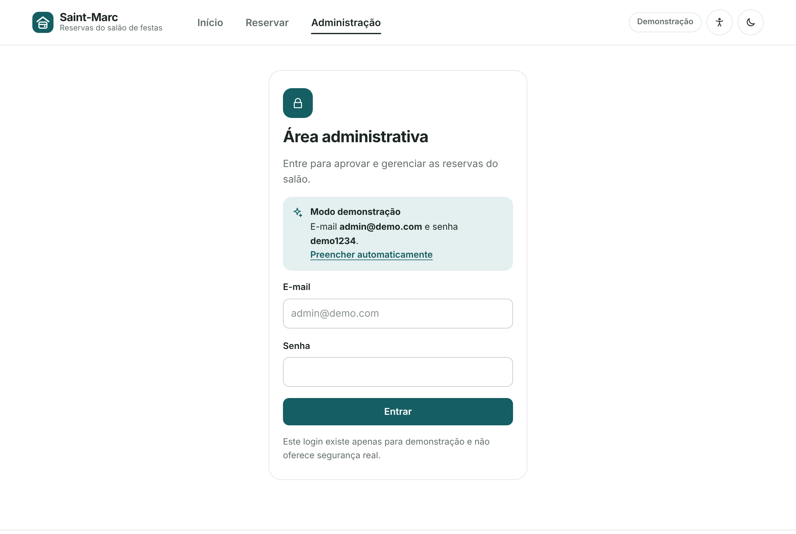
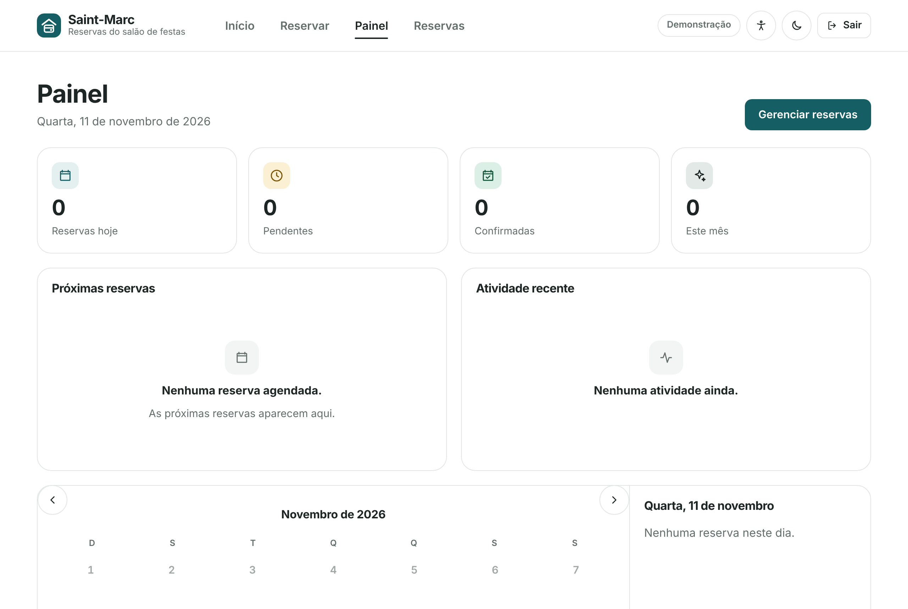

# Guia da administração

## Entrar

Abra **Administração** no menu.

- **Modo local:** no primeiro acesso a tela pede para **criar a conta do administrador** (e-mail e senha de pelo menos 8 caracteres). Depois disso, só essa conta entra. Não existe conta padrão. A conta fica guardada neste navegador; se perder a senha, apague os dados do site no navegador e crie outra (isso também apaga as reservas daquele aparelho).
- **Modo conectado:** entre com a conta criada no Supabase e cadastrada como administradora (veja [Banco de dados real](SETUP_SUPABASE.md#passo-3-criar-a-conta-da-administracao)). A sessão é renovada sozinha; se expirar, o sistema volta ao login com um aviso.

## Painel

Mostra reservas de hoje, pendentes, confirmadas e do mês, as próximas reservas, a atividade recente e o calendário completo, com os detalhes do dia escolhido.

## Reservas

A página **Reservas** lista todas as solicitações. Use a busca (nome, unidade, telefone ou data) e os filtros por status e data.

Em cada reserva:

- Pedido **pendente**: **Aprovar** ou **Rejeitar**. Reserva **aprovada**: **Cancelar reserva**. Uma reserva **rejeitada** ainda pode ser aprovada depois (o sistema confere o conflito de novo). Rejeitadas e canceladas liberam o horário.
- **Excluir**, com confirmação antes.
- **Ligar** para o morador ou abrir o **WhatsApp** com mensagem pronta.

### Avisar o morador

Ao aprovar, rejeitar ou cancelar, o painel mostra a mensagem pronta com nome, data e horário. Toque em **Enviar no WhatsApp** (abre a conversa já preenchida) ou **Copiar mensagem**. Na aprovação, a mensagem leva também o link do Google Agenda e, se configurada, a frase fixa `AVISO_EXTRA` (por exemplo, horário de silêncio). O envio é feito por você, com um toque; não há envio automático.

## Moradores

A aba **Moradores** mostra os cadastros feitos pelos moradores, um por apartamento: nome, telefone e unidade. Há busca, botões de **Ligar** e **WhatsApp**, e **Remover** (a pessoa pode se cadastrar de novo). A senha do morador nunca aparece. Se um morador esquecer a senha, remova o cadastro dele para que ele crie outro.

## Lista de espera

Quando alguém entra na lista de espera de um dia, ela aparece em **Reservas**. Se a reserva daquele dia for cancelada ou rejeitada, os detalhes mostram quem está esperando, com **Avisar que liberou** (WhatsApp) e **Remover**.

## Datas bloqueadas

No **Painel**, na seção **Datas bloqueadas**, informe o primeiro dia, o último (opcional) e o motivo, e toque em **Bloquear**. Os moradores veem "Salão fechado neste dia", o dia sai dos próximos dias livres e o banco recusa novas reservas. Se já houver reservas no período, o painel avisa. Para reabrir, remova o bloqueio.

## Modo local

No modo local (demonstração), a página **Reservas** tem o botão **Apagar dados deste navegador**, que remove reservas, cadastros de moradores, esperas e bloqueios guardados naquele aparelho (a conta do administrador continua). No modo conectado esse botão não existe, para ninguém apagar dados reais sem querer.

## Boas práticas

- Responda os pedidos pendentes rapidamente: o morador só tem certeza depois da aprovação.
- Use bloqueios para datas de manutenção e assembleias antes de aprovar eventos próximos.
- Mantenha as regras do salão atualizadas (veja [Personalização](PERSONALIZACAO.md)).
- Use senhas fortes e crie uma conta por administrador.
