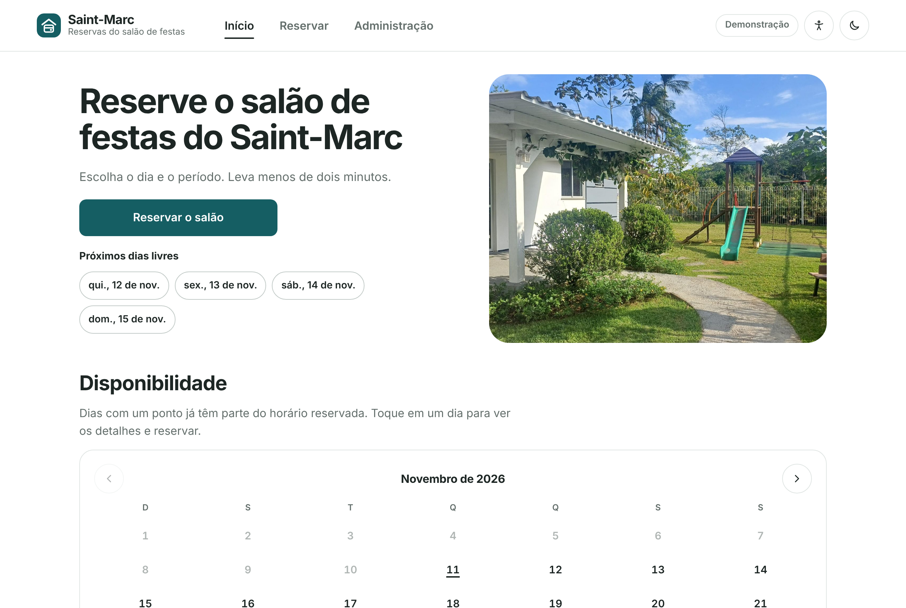
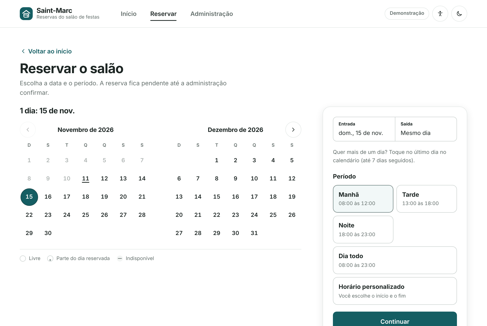
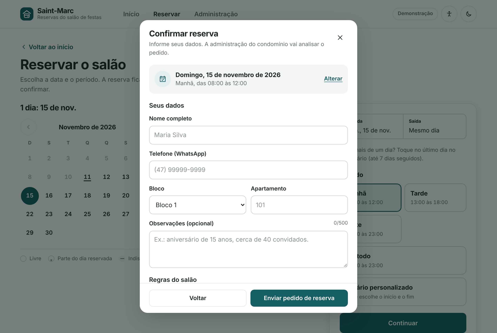

# Guia do morador

## Ver os dias livres

Na página inicial aparecem os **próximos dias livres** e o calendário de disponibilidade.

- Dia com um **ponto**: parte do horário já está reservada.
- Dia **riscado**: indisponível (reservado o dia todo, passado ou fechado pela administração).
- O calendário nunca mostra nomes ou telefones de ninguém.

## Cadastrar o seu apartamento

Na aba **Cadastro**, informe nome, telefone, bloco, apartamento e escolha uma **senha de 4 a 6 números**. Os dados ficam salvos no sistema, ligados ao seu apartamento, e nas próximas reservas já vêm preenchidos. Cada apartamento tem um cadastro.

- Já se cadastrou? Use **Já tenho cadastro** e entre com bloco, apartamento e senha.
- Em **Minha conta** você atualiza o nome e o telefone (confirmando a senha) ou sai da conta.
- A senha protege os seus dados: sem ela ninguém vê o seu nome e telefone. Depois de 5 senhas erradas o apartamento fica bloqueado por 15 minutos (modo conectado).
- Esqueceu a senha? Peça à administração para remover o cadastro e faça outro.

O cadastro é opcional: quem não se cadastrar continua podendo reservar, preenchendo os dados a cada vez.

## Fazer uma reserva

1. Toque em **Reservar o salão** (ou em um dia livre).
2. Toque no dia desejado. Para **mais de um dia** (até 7 seguidos), toque no primeiro e depois no último dia.
3. Escolha o período: **Manhã** (08:00 às 12:00), **Tarde** (13:00 às 18:00), **Noite** (18:00 às 23:00), **Dia todo** ou **Horário personalizado**. Em reservas de vários dias o salão fica reservado o dia todo.
4. Toque em **Continuar**.
5. Preencha nome, telefone com DDD, bloco, apartamento e, se quiser, observações (se você tem cadastro e está na sua conta, tudo já vem preenchido).
6. Leia as **regras do salão** e marque "Li e aceito as regras".
7. Toque em **Enviar pedido de reserva**.

A reserva fica **pendente** até a administração analisar. A resposta chega pelo WhatsApp, no número informado.

## Guardar na agenda

Depois de enviar, aparecem dois botões: **Agenda do celular** (arquivo `.ics`, com lembrete um dia antes) e **Google Agenda**.

## Dia ocupado? Entre na lista de espera

Ao tocar em um dia que já tem reserva, use **Avise-me se este dia liberar**. Informe nome, telefone e apartamento. Se a reserva for cancelada ou recusada, a administração pode avisar você. Cada telefone pode esperar por até 3 dias ao mesmo tempo.

## Dia fechado

Quando a administração fecha o salão (manutenção, assembleia, obra), o dia aparece como **Salão fechado neste dia** e não aceita reservas.

## Instalar como aplicativo

No site publicado, use **Instalar o app no celular** no rodapé. No iPhone: Compartilhar > Adicionar à Tela de Início. O app abre pelo ícone, sem a barra do navegador.

## Acessibilidade e aparência

O botão de acessibilidade (boneco no topo) permite ajustar o tamanho do texto, alto contraste, destacar o foco, reduzir animações, espaçar o texto, não depender de cor e usar uma fonte simples. O botão de lua alterna entre tema claro e escuro. As escolhas ficam salvas no aparelho.

Em datas comemorativas (Natal, Páscoa, Carnaval, Dia das Mães e outras) a página inicial ganha enfeites automaticamente.

## Problemas comuns

| Situação | O que fazer |
| --- | --- |
| "Horário ocupado" ao enviar | Alguém reservou esse horário antes. Escolha outro período ou entre na lista de espera. |
| Botões não respondem | Abra o site direto no Chrome ou Safari, e não dentro de um visualizador de arquivos ou de um app de mensagens. |
| Telefone recusado | Informe DDD e número, por exemplo (47) 99999-9999. |
| Sem internet | A tela inicial abre, mas os horários só carregam com conexão (modo conectado). |
