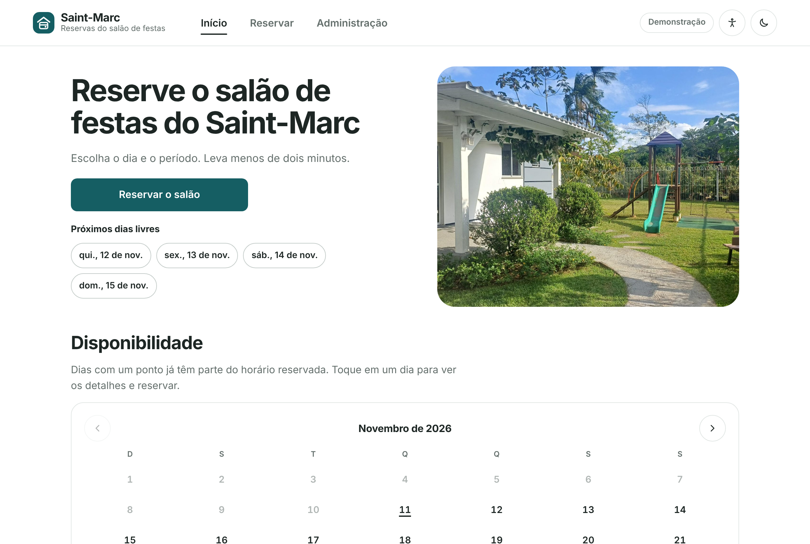
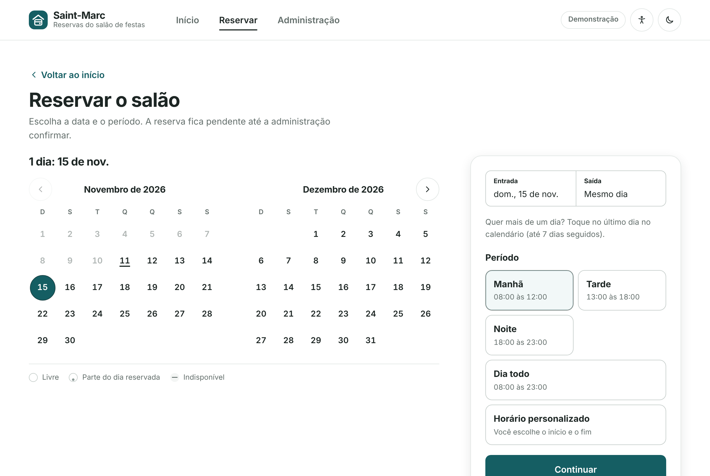

# Documentação do Reservas Saint-Marc

Índice da documentação completa. Comece pelo guia que combina com o seu papel.

| Para quem | Documento |
| --- | --- |
| Moradores | [Guia do morador](GUIA_DO_MORADOR.md): como reservar, entrar na lista de espera e guardar a data na agenda |
| Administração do condomínio | [Guia da administração](GUIA_DA_ADMINISTRACAO.md): aprovar, avisar moradores, bloquear datas |
| Quem vai instalar e publicar | [Instalação e publicação](INSTALACAO_E_PUBLICACAO.md) e [Banco de dados real (Supabase)](SETUP_SUPABASE.md) |
| Quem vai ajustar o sistema | [Personalização](PERSONALIZACAO.md) |
| Quem quer entender as regras | [Regras de negócio](REGRAS_DE_NEGOCIO.md) |
| Quem vai mexer no código | [Arquitetura](ARQUITETURA.md) e [Banco de dados](BANCO_DE_DADOS.md) |
| Quem vai testar | [Plano de testes](TESTES.md) |
| Curiosos | [Histórico de versões](HISTORICO.md) |

## O que é o sistema

O Reservas Saint-Marc permite que os moradores reservem o salão de festas do condomínio pelo celular e que a administração aprove e acompanhe tudo em um painel. Não há cobrança: o sistema só organiza as datas e os horários.

Ele funciona em dois modos, escolhidos automaticamente:

- **Modo local:** nada para configurar. Começa vazio e guarda os dados só no navegador de quem usa. Serve para conhecer e testar. No primeiro acesso à Administração você cria a conta do administrador (e-mail e senha), guardada neste navegador. Não há conta padrão, mas também não é segurança de servidor.
- **Modo conectado (uso real):** todos os aparelhos enxergam as mesmas reservas, em um banco compartilhado (Supabase), com login de administrador de verdade.

## Capturas de tela

| Início | Escolha do período |
| --- | --- |
|  |  |
